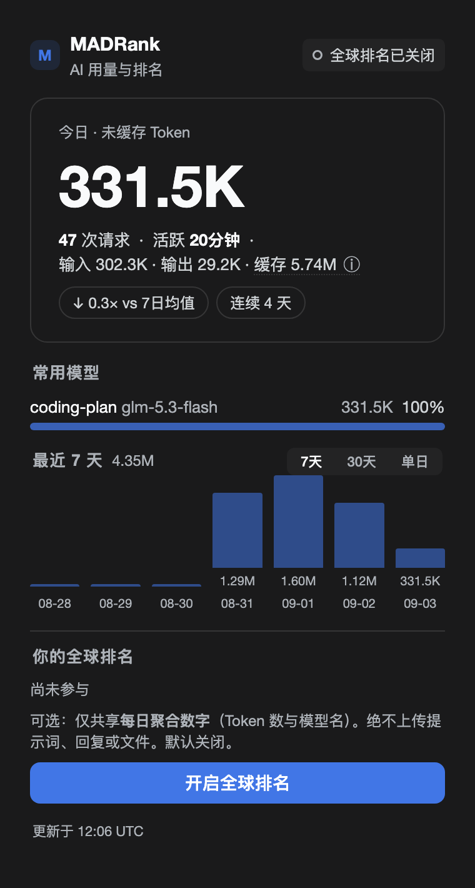
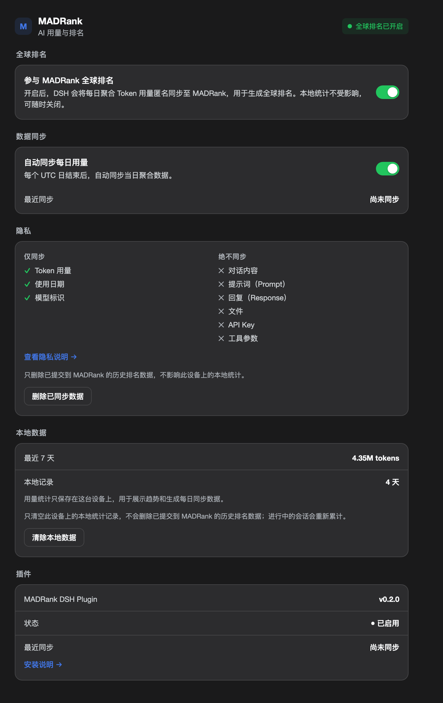

# MADRank for DSH

> **Track your AI usage. See how you rank.**

[](https://www.npmjs.com/package/@qomob/dsh-madrank)
[](./LICENSE)
[](https://madrank.ai)

**English** | [简体中文](./README.zh-CN.md)

MADRank is an AI Usage & Ranking plugin for [DeepSeek Harness (DSH)](https://github.com/qomob/dsh). It turns your DSH activity into a private local dashboard — Today / 7-Day history / Top models / Streak — and, if you explicitly opt in, an anonymous global **7-Day Token Race** based on real usage.

The core principle is simple: **local tracking runs by default, global ranking is an explicit opt-in, uploads only happen for finished UTC days, and only aggregated usage is ever sent.**

<p align="center">
  &nbsp;&nbsp;&nbsp;&nbsp;
  
</p>
<p align="center"><sub>Left: sidebar MADRank card (real local data) · Right: the Settings tab inside the same card</sub></p>

---

## Features

**1. Local AI Usage Dashboard** (works fully offline, no ranking required)

* **Today** — today's usage
* **7-Day / 30-Day History** — recent 7-day / 30-day trends
* **Top Models** — your most-used models
* **Streak** — consecutive active days
* **vs 7-Day Average** — compare against your own 7-day baseline
* **RANK** — global rank status
* **Cached Tokens** — tracked separately from the ranking metric

Data comes from the DSH session projection feed — the plugin never reads DSH's internal database directly.

**2. 7-Day Token Race** (the core competitive metric)

> **7-Day Total** — your primary tokens over the last **7 UTC days**.

```text
Primary Tokens = uncached input tokens + output tokens
Cached Tokens  = cache read + cache write
```

A note on honesty: the race figure is the full input+output as uploaded (uncached input + cache write + output); **cache reads are reported separately and never counted** toward the race. "Uncached" on the local dashboard refers to your local primary (uncached input + output) — the two numbers answer different questions, and the card labels both: local figures are marked **LOCAL · LIVE**, race figures carry the server sync time. This keeps read-cache differences from distorting comparisons while staying truthful about what is counted.

**3. Opt-in Global Ranking**

Nothing is uploaded by default. Sync only starts after you explicitly enable **join the global ranking**:

* Off by default, explicit opt-in
* No real-time requests, no same-day data ever
* Only **finished UTC days** are uploaded, as per-day per-model aggregates
* Sync failure never affects local statistics

**4. One-click Share Card**

The **share button** on the Quick View card turns your rank into a postable card:

* **Dedicated share link** — `https://madrank.ai/share/<shareToken>`, viewable from any device by anyone
* **Auto-generated social card image** — rendered server-side (7-day token total, global rank, brand mark, QR code to madrank.ai); social platforms pick it up automatically as the card preview
* **Copy-ready bilingual share text** — with rank and model info
* **Server-authoritative numbers** — refreshed from the server (`/api/usage/me`) right before sharing, so stale local caches never leak stale numbers into your posts

Sharing uploads no new private data: the share token only addresses your anonymous node on a public leaderboard, and the leaderboard itself is public.

---

## Privacy by Design

Local tracking and global sync are separated at the architecture level.

```text
Default (offline-capable):
DSH → Local Projection → Local Usage Store → Local Dashboard

After joining the race:
Local Usage Store → Finished UTC Day → Aggregated Usage → MADRank Ingest
```

**Never uploaded:** prompts, responses, tool arguments, individual request payloads, same-day usage.
**Uploaded:** daily, per-model aggregated usage only.

Two deletion controls live in the card's Settings tab (both require confirmation):

- **Clear local data** — removes this machine's local statistics from the clearing moment on; days before it no longer appear in the card and are no longer uploaded.
- **Delete uploaded ranking data** — asks MADRank to delete the anonymous daily rows already submitted from this installation; local statistics stay untouched.

The anonymous share token is kept in the DSH credential store when the profile provides one, so `~/.madrank/usage/global-rank.json` no longer contains it in plaintext (files fall back to the old behavior only when the credential service is absent).

---

## Usage Accuracy

MADRank does not invent a second token-accounting logic. It uses DSH's **session projection** as the data source and reconciles aggregation against an independent reference token-meter. A real-session reconciliation run:

```text
input        745,120  =  745,120
output       186,324  =  186,324
cache read 26,352,384 = 26,352,384

MATCH ✓
```

The suite covers streaming replacement, waterfall tool traffic, cross-midnight bucketing and `(turn, step)` replacement semantics. Goal: stay consistent with DSH's own token meter.

---

## Installation

> A DSH plugin is mounted from a **profile**. Two things must both be true, or the plugin silently does nothing:
> 1. the package is **declared/installed** in the profile (`package.json` + `node_modules`, via `dsh plugin … add`);
> 2. the profile **mounts** it — a `cordis.patch.yml` insert entry.
>
> The published package ships the Host half **compiled to JavaScript** (`dist/host/`) and the browser half prebuilt (`dist/client.js`) — consumers need no build step. (Node refuses to type-strip TypeScript inside `node_modules`, which is why installed packages must not point `main` at a `.ts` file.)

### Option 1: Desktop app's built-in plugin manager (recommended for the app)

Open the sidebar **Plugins** page (the plugin manager; *Settings → Plugins* is a read-only list) and install from one of:

* **GitHub** — repository `qomob/dsh-madrank`
* **npm** — package `@qomob/dsh-madrank`

Then **fully quit and reopen the app** (the profile composition is loaded at startup; reloading the page is not enough). If the manager leaves the plugin un-mounted, add the mount entry below, then restart.

### Option 2: CLI (any profile: `desktop`, `web`, …)

```bash
# GitHub (always the latest `main`)
dsh plugin --profile desktop add github:qomob/dsh-madrank

# …or the published npm package
dsh plugin --profile desktop add @qomob/dsh-madrank
```

`dsh plugin` forwards to pnpm inside `~/.dsh/profiles/<profile>/`, which declares the dependency properly (an undeclared package gets pruned on the next `pnpm install`).

Then add the mount entry to `~/.dsh/profiles/<profile>/cordis.patch.yml`:

```yaml
- insert:
    - id: madrank
      name: '@qomob/dsh-madrank'
```

And restart DSH.

### Option 3: local development (live edits)

```bash
git clone https://github.com/qomob/dsh-madrank.git
cd dsh-madrank && npm install && npm run build
dsh plugin --profile desktop add 'link:/absolute/path/to/dsh-madrank'
```

Use `link:` not `file:` (`file:` copies the package and breaks source sync). With `link:` the profile loads the built `dist/` — run `npm run build` after source edits, then restart. Add the mount entry and restart as above.

### Verify

* the sidebar shows the **MADRank** entry;
* the log shows `madrankUsage projection registered` and `settings ns registered: madrank-usage`.

### Troubleshooting — installed but nothing appears

| Symptom | Check |
| --- | --- |
| No MADRank entry, no log lines | Mount entry missing from `cordis.patch.yml` |
| Plugin gone after an unrelated install | Dependency not declared in the profile `package.json` (re-run `dsh plugin … add`) |
| "settings ns registered" missing | Profile never restarted, or the app was only reloaded |
| Older UI/copy than this README | npm install of an older version — use the GitHub spec, or upgrade (`dsh plugin --profile desktop add @qomob/dsh-madrank@latest`) |
| Installed, enabled, but runtime says not running (v0.3.6 or earlier) | That release pointed `main` at `src/index.ts`; Node cannot type-strip TS under `node_modules`. Upgrade to **v0.4.0+**, which ships compiled `dist/host/` JS |

---

## UI Model

```text
Sidebar → Quick View = VIEW
MADRank card → Settings = CONFIGURE
```

The MADRank card shows your usage, 7-day trend, model mix and rank (tab 1: AI usage & rank), and its Settings tab controls the join switch, auto-sync, privacy, local/remote deletion and plugin status. The share button opens the share sheet. The card is opened from the sidebar entry between Plugins and Media Desk.

---

## 💬 Join the Community

Scan the QR code to join the DSH plugin community — discuss DSH usage, plugin development and best practices:

<div align="center">


</div>

> The WeChat group QR code expires periodically. If it stops working, leave a message in [Issues](https://github.com/qomob/dsh/issues) and we will refresh it.

---

## Architecture

```text
┌──────────────────────┐
│   DSH Session Logs   │
│    Source of Truth   │
└──────────┬───────────┘
           ▼
┌──────────────────────┐
│  sessionProjections  │
│     madrankUsage     │
└──────────┬───────────┘
           ▼
┌──────────────────────┐
│      UsageStore      │
│  local usage cache   │
└──────────┬───────────┘
      ┌────┴─────┐
      ▼          ▼
   Local UI    Daily Sync
                   │
                   ▼
            MADRank Ingest
                   │
                   ▼
           7-Day Token Race
```

DSH session logs are the source of truth; the plugin reads `sessionProjections` (never SQLite directly), keeps a rebuildable local cache, and keeps daily sync fully isolated from local statistics. All DSH coupling lives in `src/compat.ts` — verifiable via `npm run verify:dsh`.

Integration follows the current official plugin model (`cordis-plugin-development` references): the bundle declares `dsh.bundle.patch`; the Host exports `apply(ctx, config)` with `inject` plus a schemastery `Config`, awaits the 0.2.x `sessionProjections.register()` handle and disposes it on unload, and prefers the official `timer` service. The Client is a lazy `window.__ModuleLoader__` factory that registers two additive slots — `settings.section` (the configuration page) and `sidebar.footer.action` (the Quick View entry) — and reads session data through the slot's standard `useSessions` props.

Non-negotiables: never fork DSH · never read internal SQLite directly · never duplicate token-meter semantics · never create an independent session event pipeline · never upload same-day usage · never upload prompts/responses/tool arguments · never let global sync block local statistics.

---

## Storage

Default directory `~/.madrank/usage/` (override with `MADRANK_USAGE_DIR`): `installation-id`, `usage-store.json`, `card-snapshot.json`, `global-rank.json`, `debug.log`. The anonymous identity is a locally generated installation UUID; a new machine means a new identity by default.

---

## Development

```bash
npm install
npm test
npm run typecheck
npm run build:client
npm run reconcile -- <events.jsonl>
npm run reconcile:fixture
npm run verify:dsh
npm run preview
```

TypeScript · React · Zod · Vitest.

---

## Project Status

Local usage projection, 7/30-day history, top models, streak, Quick View, Settings and the daily aggregated sync protocol are implemented; golden-case and real-traffic reconciliation and DSH compatibility verification pass.

**v0.6.0 targets DSH 0.2.2-rc.1** (`engines.dsh: >=0.2.2-rc.1 <0.3.0`; plugin model: `Config` + `configForms` + slot-prop session data). On older DSH builds the browser half waits for activation — upgrade DSH first. The Host syncs daily aggregates to MADRank and publishes the accepted race record through a dedicated client-visible projection (`madrankRank`).

---

## Related Projects

The MADRank ecosystem goes beyond the DSH plugin:

* **[madrank-node](https://www.npmjs.com/package/@qomob/madrank-node)** — official CLI collector: reads real usage from local Claude Code / Codex / OpenCode / Gemini CLI / DSH logs, aggregates, and optionally uploads, sharing the same anonymous identity with this plugin
* **[madrank-sync](https://github.com/qomob/madrank-sync)** — skill marketplace distribution: AI agents (Claude Code / DSH, etc.) collect and upload via a skill, with built-in integrity self-check and anti-fabrication guardrails

---

## Disclaimer

This project is a community-driven, unofficial project and is not affiliated with DeepSeek AI. "DeepSeek", "dsh", "DeepSeek Harness" and related names and trademarks belong to their respective owners.

---

🌐 https://madrank.ai

## License

[MIT](./LICENSE) © 2026 qomob / MADRank

